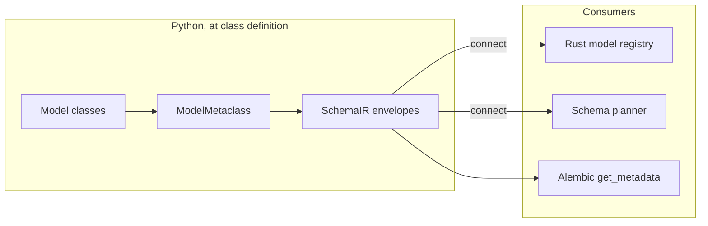
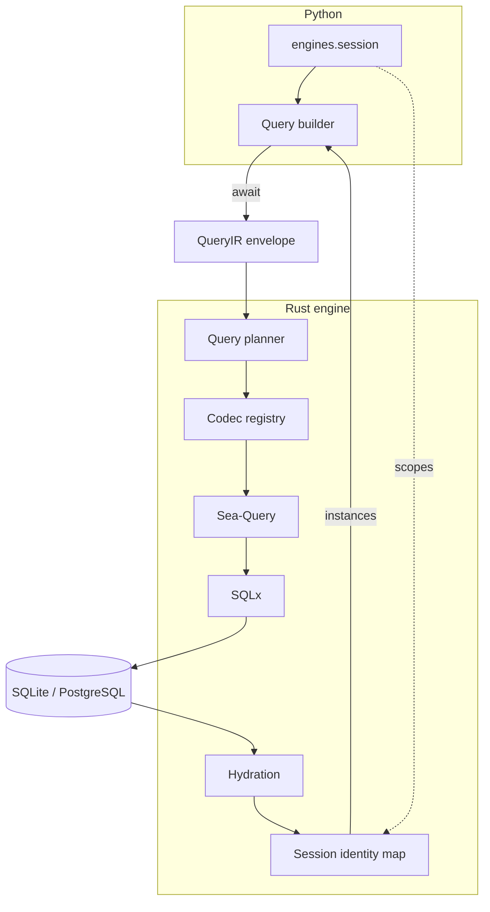
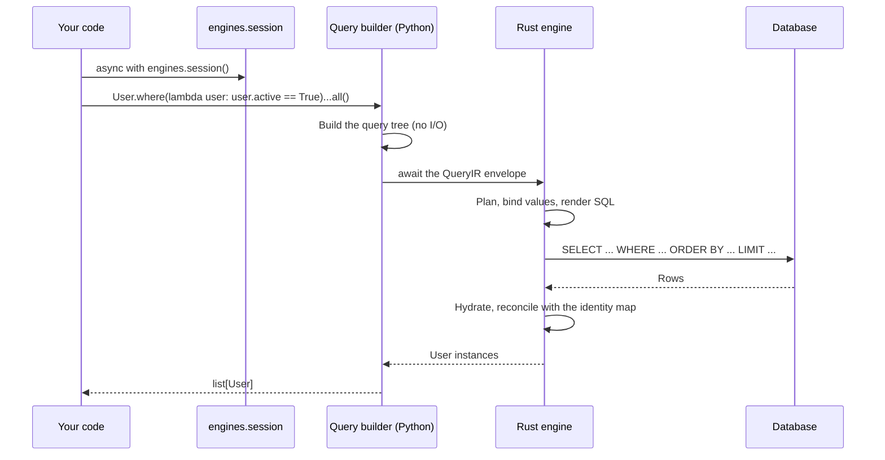
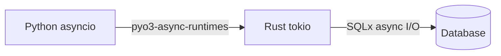

# Architecture

This page follows one model and one query through Ferro's layers: what runs in Python, what crosses into Rust, and when the database is involved.

The running example is a `User` model:

=== "Assignment"

    ```python
    --8<-- "docs/examples/concepts.py:models"
    ```

=== "Annotated"

    ```python
    --8<-- "docs/examples/concepts_annotated.py:models"
    ```

With four users saved, this query reads the active ones, oldest first:

```python
--8<-- "docs/examples/concepts.py:query"
```

Edsger is inactive, so three users come back. Python built the query, Rust wrote the SQL, ran it and turned the rows into `User` instances, and the session decided which connection ran it. The rest of this page takes those steps one layer at a time.

## Two pipelines

Ferro does its work at two different times:

- **When a model class is defined**, Ferro compiles its schema. This happens once, at import, and touches no database.
- **When you await a query or a write**, Ferro runs it. This happens on every `await`, inside a session.

### Schema path

Defining `User` runs the model's metaclass, which compiles the class into a **SchemaIR** envelope: a versioned, JSON-shaped description of the table, its columns, keys, indexes and constraints. The envelope is kept in Python. When you call `connect()`, Ferro installs the whole set of model envelopes into the Rust engine in one step, and every consumer of the schema reads that one description:



The registry gives the engine each column's type for binding values and hydrating rows. The planner compares the models with a database and writes the DDL; auto-migrate, `ferro migrate new` and the Alembic bridge all use it, which is covered in [Schema changes](#schema-changes) below.

### Runtime path

Awaiting a query runs it inside the active session. The query crosses into Rust as a **QueryIR** envelope, and Rust owns the SQL, the database I/O and the hydration of rows into instances:



Each layer owns one part of the work:

| Layer | Owns |
| :--- | :--- |
| Python | Models, validation, building queries |
| SchemaIR and QueryIR | The contracts that cross from Python to Rust |
| Rust engine | Planning, value conversion, hydration |
| Sea-Query | The shape of the SQL for each dialect |
| SQLx | Connection pools and database I/O |
| Sessions | Which connection runs the work, transactions, the identity map |

The backend decides which database-specific path is legal: a SQLite pool and a PostgreSQL pool are separate types, not one abstraction pretending to be both.

## Layers

### Python

Ferro models are Pydantic v2 `BaseModel` subclasses, and the Python layer owns everything you write:

- **Model definition.** Annotated fields become columns; Pydantic handles validation, defaults, serialization and JSON schema generation. See [Type safety](type-safety.md).
- **Schema compilation.** The metaclass reads each model at class definition (primary key, uniques, indexes, foreign keys, nullability, composite constraints) and compiles its SchemaIR envelope.
- **Query building.** Each call in `User.where(...).order_by(...).limit(10)` returns a new, immutable query and touches no database. Nothing runs until you await a terminal method such as `.all()`, `.first()`, `.count()`, `.exists()`, `.update()` or `.delete()`. The lambda's parameter is a [`QueryProxy`][ferro.query.QueryProxy] that checks each attribute name as the lambda runs; [Typed query predicates](query-typing.md) explains it.
- **Session routing.** ORM and raw SQL calls run inside an active `engines.session()` block, or take an explicit `session=` handle.

### Bridge

The boundary between Python and Rust is built on [PyO3](https://pyo3.rs), with `pyo3-async-runtimes` connecting Python's asyncio event loop to Rust's tokio runtime. Three things cross it:

- **SchemaIR** (`ir_kind: "schema"`): one envelope per model, compiled at class definition and installed into the engine by `connect()`. The Alembic bridge's `get_metadata()` reads the same envelopes.
- **QueryIR** (`ir_kind: "query"`): one envelope per operation, `{ir_kind, ir_version, payload}`. Rust plans SQL from it and binds every value through the codec registry.
- **Rows**, on the way back, which Rust hydrates into Python instances.

While Rust waits on the database, it holds no Python lock: the await runs on tokio, so other coroutines and threads keep running. [Async from end to end](#async-from-end-to-end) covers what that means for concurrent work.

### Rust engine

The engine owns everything between the QueryIR envelope and the database:

- **Query planning.** The QueryIR payload becomes Sea-Query conditions, with each bound value typed from the model's schema.
- **Codec registry.** One set of conversions for inserts, updates, filters, many-to-many links and hydration: typed `NULL`s, UUIDs, decimals, dates and times.
- **SQL generation** through [Sea-Query](https://github.com/SeaQL/sea-query), with the SQLite or PostgreSQL builder and bound parameters. Values are bound, never interpolated into the SQL.
- **Connection pooling and execution** through [SQLx](https://github.com/launchbadge/sqlx) typed pools.
- **Hydration.** Rust decodes each row and fills the instance's fields directly, without calling the model's `__init__`, and sets the Pydantic attributes `__init__` would set (`__pydantic_fields_set__`, `__pydantic_extra__`, `__pydantic_private__`). A hydrated `User` behaves like one you constructed.
- **Session identity map**, so one row is one Python instance within a session. See [Identity map](identity-map.md).

## Life of a query

The query from the top of the page goes through these steps:



Step by step:

1. **Session.** `async with engines.session():` sets the connection that ORM and raw SQL calls inside it use. You can pass `session=` explicitly instead.
2. **Construction.** `User.where(lambda user: user.active == True)` calls the lambda once with a proxy and builds a query tree in Python. No database is involved.
3. **Execution.** Awaiting `.all()` wraps the query in a QueryIR envelope and calls into Rust.
4. **SQL generation.** The planner and the codec registry turn the envelope into parameterized SQL for the connection's dialect.
5. **Execution.** SQLx runs the statement on a pooled connection, or on the pinned connection of an open [transaction](../guide/transactions.md).
6. **Hydration.** Rust decodes each row and checks the session's identity map, so a row you already hold comes back as the instance you hold.
7. **Return.** Your code receives a `list[User]`.

## Schema changes

Defining `User` compiles its schema, but connects to nothing. The schema reaches a database when you connect with auto-migrate:

```python
--8<-- "docs/examples/concepts.py:connect"
```

That call creates the `user` table, because no table of that name existed. `auto_migrate=True` creates missing tables and leaves existing ones alone; `migrate_updates=True` and `migrate_destructive=True` go further, and [Auto-migrate](../guide/schema/auto-migrate.md) lists what each one changes.

Auto-migrate, [migrations](../guide/schema/migrations.md) (`ferro migrate new`) and the [Alembic bridge](../guide/schema/alembic.md) are three doors to the same planner. Each compares the models' SchemaIR with a database or a saved snapshot, and each renders the change through the same functions. Because they share one planner, they write the same statement for the same change, byte for byte, so switching from one to another never shows a phantom difference. [Schema management](../guide/schema/overview.md) compares the three.

## Async from end to end

Ferro has no synchronous API and no thread pool wrapping a synchronous driver. Python's `await` hands off to Rust's tokio runtime, and SQLx talks to the database asynchronously:



Three consequences follow:

- Database I/O never holds Python's interpreter lock, so other coroutines keep running while queries are in flight.
- Concurrent tasks share the connection pool when each task opens its own session, or routes with an explicit `session=`.
- [Sessions](../guide/connections.md#sessions) and [transactions](../guide/transactions.md) pin the work inside them to a connection and an identity map through context variables.

## Trade-offs

The design has costs:

- **A compiled wheel.** Ferro ships a compiled extension module. Prebuilt wheels cover the common platforms; anywhere else, installing builds from source with a Rust toolchain.
- **Debugging crosses a language boundary.** A Python traceback stops where the call enters Rust. Ferro raises Python exceptions with clear messages, but you cannot step a Python debugger into SQL generation or hydration.
- **Limited runtime introspection.** You cannot monkeypatch the engine's internals or hook arbitrary points of the execution pipeline from Python.
- **A young ecosystem.** Ferro is pre-1.0, with a small community, fewer integrations and fewer answered questions online than SQLAlchemy or the Django ORM.

## See also

- [Identity map](identity-map.md): one row, one instance, within a session
- [Typed query predicates](query-typing.md): lambda predicates and how they are checked
- [Type safety](type-safety.md): the Pydantic integration
- [Database backends](backends.md): SQLite and PostgreSQL differences
- [Performance](performance.md): where the Rust core helps
- [Schema management](../guide/schema/overview.md): auto-migrate, migrations and the Alembic bridge
